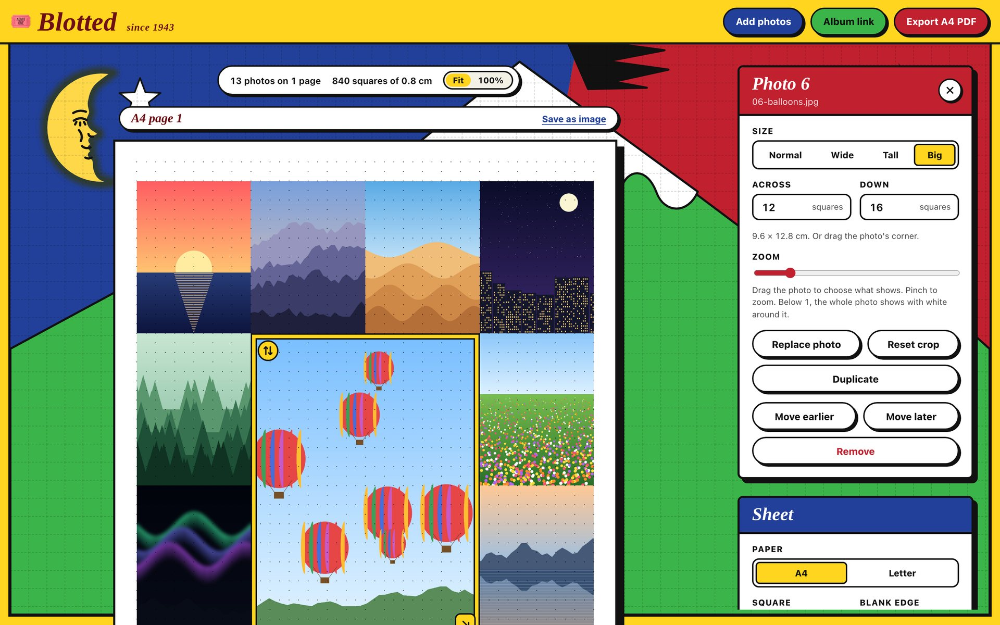
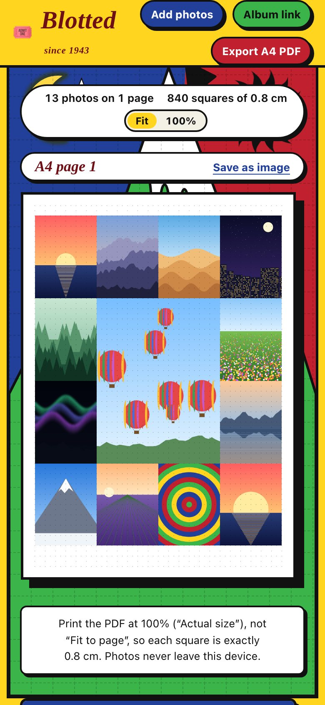

# Blotted 🎟️

Lay photos on a dotted cut grid and export a print-ready page, to cut into small squares (blotter style).
https://blotted.vumble.dev

<p align="center">
  
</p>
<p align="center">
  
</p>

The screenshots use drawn sample images, not real photos.

- **Add photos**: the button, drag and drop, or paste. On iOS the button opens the photo library. A loader counts
  the photos in. Photos are kept at full size for the exports; the screen shows light copies, so any phone copes.
- **Album link**: paste a Google Photos album shared by link, tick the photos, add them at full size. Photos already
  on the sheet start unticked. The picker sits in the side column (a drawer on phones). The server reads the
  album's public page (`api/album.ts`, Google has no API for shared albums) and passes the photos through, as
  Google serves them without CORS headers.
- **Arrange**: drag a photo to choose what shows, pinch (or Ctrl and the wheel) to zoom in or out (below 1 the whole
  photo shows, with white around it), drag its ⇅ handle onto another photo to swap them. Each photo can be Normal,
  Wide, Tall, Big, or any size in squares: drag its corner or type it. Duplicate copies a photo.
- **Sheet**: A4 or Letter, square size (0.8 cm by default; the usual blotter is ¼ in), photo shape (3:4, 1:1, 4:3),
  blank edge for the printer, dot spacing. Photos fit the page by default: they grow to fill it and shrink as more
  are added, in whole squares; or set a fixed size.
- **Grid**: black dots on every square of the page, empty places included; photo edges are always cut lines.
- **Export**: a PDF at the paper's exact size (vector dots, photos at 300 dpi), or a JPEG of one page. Print at 100%.
- Photos and layout stay on the device (IndexedDB); your own photos are never uploaded. Works offline once opened.

## Develop

```sh
npm install
npm run dev      # http://localhost:5194, with /api/ served too
npm test         # layout, crop and dot maths (src/layout.ts)
npm run build
npm run format
```

Vite, React, TypeScript, jsPDF. Hosted on Vercel; `sw/sw.js` keeps the app on the device (see
`papyrus/guidelines/web-apps.md`).
